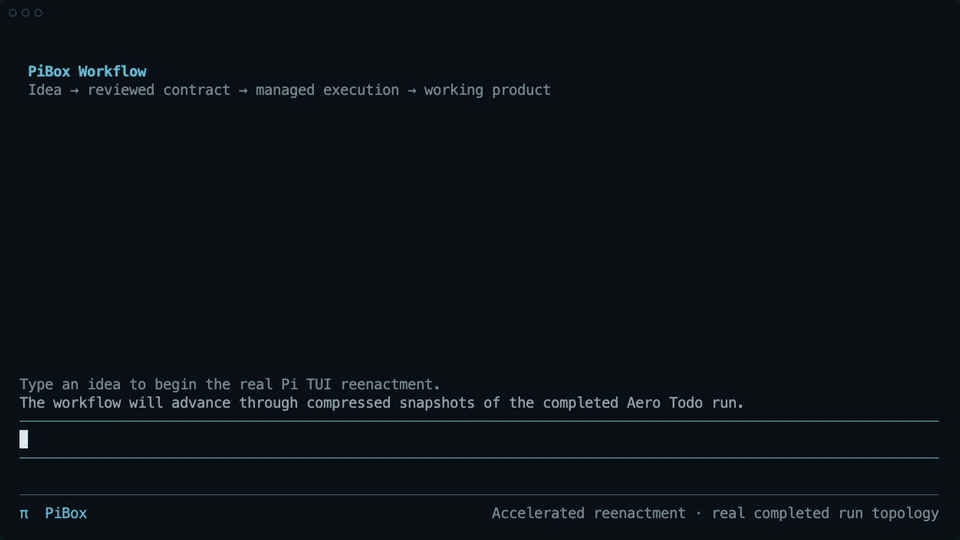
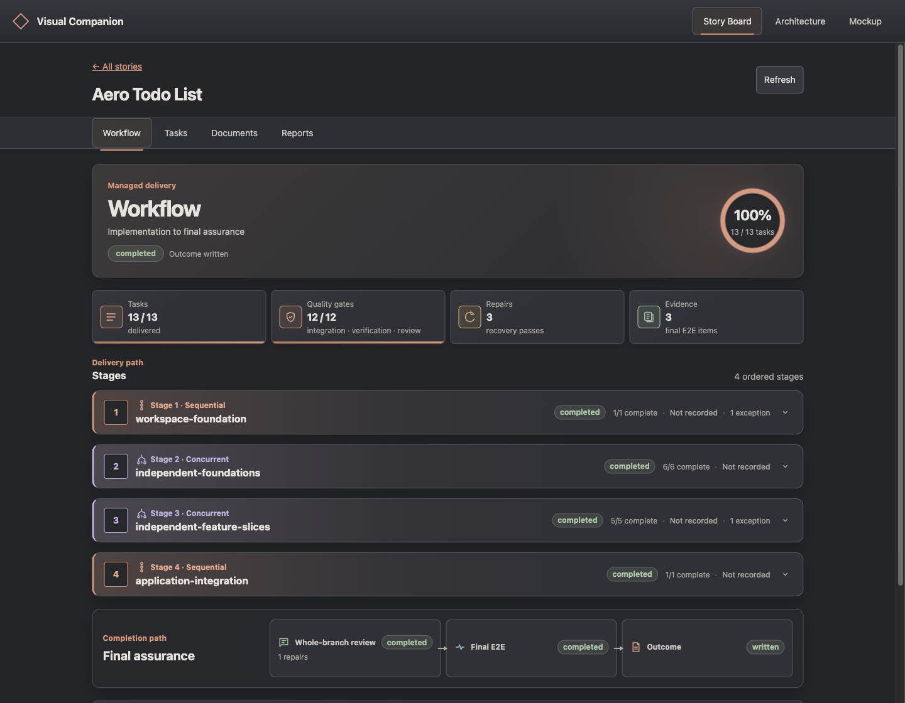
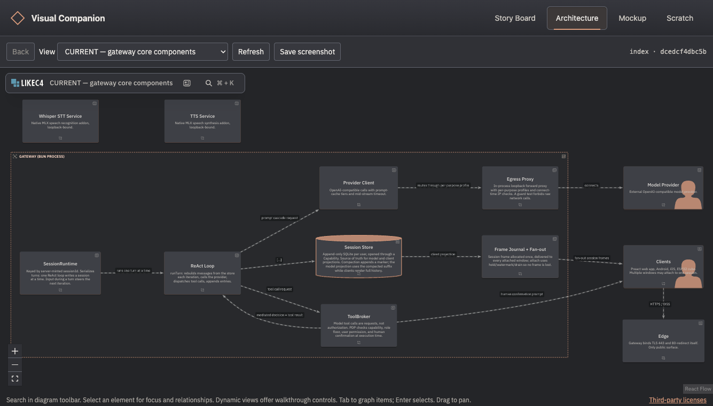

<h1 align="center">
  
</h1>

<p align="center">
  <a href="https://github.com/dev32-io/PiBox/actions/workflows/ci.yml?query=branch%3Adevelop"></a>
  <a href="LICENSE"></a>
  <a href="https://github.com/badlogic/pi-mono"></a>
</p>

PiBox is a mode-driven extension pack for the [Pi coding agent](https://github.com/badlogic/pi-mono). It adds a focused terminal, activation-scoped subagents, private session scratch, repository-aware visual design, and an optional managed workflow that carries reviewed ideas through implementation and verification.

## Choose how PiBox works

New sessions start in **Orchestrator** mode; Agent remains available for direct work without the plan-approval step. From an empty editor, press `Alt+Down` to enter the interactive footer, or use `/mode <name>` directly.

| Mode | Use it for |
|---|---|
| **Agent** | Direct repository work with ordinary tools, optional scratch, and bounded subagents. |
| **Orchestrator** | Plan discussion and approval, flexible scratch, deliberate delegation, and final verification. |
| **Workflow** | Reviewed stories and plans followed by managed stages, checks, repair, review, and E2E. |
| **Designer** | Repository-aware visual exploration, mockups, and implementation handoff. |

Modes are session-branch-local and select authority, not permission: Workflow still requires separate story and plan review plus an explicit start or resume. See [work modes](docs/work-modes.md) for cache behavior, restoration, and scratch semantics.

## What PiBox adds

| Area | Highlights |
|---|---|
| **Terminal UX** | `rattle` theme, refined input, responsive status, keyboard-driven interactive footer, reusable dialogs, spinners, and compact styled transcript output with subagent lifecycle and prompt previews. |
| **Subagents** | Markdown-backed agent catalog, titled foreground/background `subagent_spawn`, explicit routing overrides, continuation, temporary report files with ordinary read/search, live progress, and event-aware `wait` without shell polling. |
| **Models and speed** | Capacity-aware fallback across managed-agent routes, tier profiles, ChatGPT Fast mode for the main agent and selected child tiers, Codex usage meters, and local LLM or Ollama Cloud support. |
| **Managed workflow** | Reviewed stories and plans, sequential or concurrent stages, isolated Git worktrees, checks, integration, bounded repair, whole-branch review, and final E2E. |
| **Context and control** | Enforced repository permissions, path-scoped rules, private session scratch with a read-only Visual Companion file explorer, proactive repository memory with visible activity, and evidence-backed distillation with explicit approval. |
| **Visual and local tools** | LikeC4 architecture exploration with nested views, search, guided walkthroughs, and screenshots; Designer authority, browser mockups, a reactive workflow board, lazy local services, and optional sound feedback. |

## Quick start

Requires **Node.js 22.22.3 or newer** and [Pi 0.99.2 or newer](https://github.com/badlogic/pi-mono/blob/main/packages/coding-agent/README.md#quick-start).

```bash
npm install
npm run verify
pi -e .
```

`pi -e .` loads PiBox for one run. To keep it installed:

```bash
pi install /absolute/path/to/PiBox
```

Pi packages run with your user permissions; review the source and configuration before installation.

Inside cmux, explicit `CMUX_WORKSPACE_ID` and `CMUX_SURFACE_ID` enable best-effort live subagent panes automatically. Use `/cmux-panes on|off|status` (no argument toggles) for the current session, or set `"cmuxPanes": { "enabled": false }` in user `settings.json` to disable them by default. Turning panes off closes viewers without stopping subagents; turning them on restores views for active attempts. Non-cmux sessions remain unchanged.

## From idea to working product



*An accelerated reenactment grounded in a completed PiBox run. [View the static poster.](docs/assets/workflow-demo/workflow-demo-poster.png)*

The main agent shapes an open request into a product contract and a separate delivery plan. You review both before execution. After an explicit start, PiBox owns stage scheduling, isolated Git worktrees, deterministic checks, integration, bounded repair, whole-branch review, and final E2E. Material decisions return to you instead of silently changing the contract.

```text
/mode workflow
/workflow init [standard|economy]
/workflow status

Discuss → review the story → review the plan → say “start the workflow”
```

Managed execution lives only within the current Pi activation; quitting is treated as a crash, not detached background operation. See the [workflow guide](docs/workflow.md) for setup, authoring, recovery, and evidence.



## Explore architecture



*Sentient gateway architecture rendered in Visual Companion—not PiBox's own architecture. Explore system boundaries and component relationships, drill into focused views, or follow a request step by step.*

Ask PiBox to explain a system visually, or invoke:

```text
/skill:architecture-visualizer Show the main responsibilities, then walk through one request.
```

The Architecture tab uses **LikeC4** in PiBox's charcoal theme. One native model supports overview and nested detail views, with search, focus mode, relationship browsing, and step-by-step dynamic walkthroughs. **Save screenshot** saves the current diagram viewport as PNG—not off-screen content or every view.

The agent authors a self-contained `.c4` file under `.pibox/visualization/architecture/`, opens it through the existing Visual Companion, and inspects rendered screenshots before claiming visual verification. Same-file edits update the browser; invalid edits show diagnostics while retaining the last valid diagram.

LikeC4 installs with PiBox, not once per session or target repository. The backend remains session-owned; rendering assets and fonts are local. No additional MCP server or agent tools are required. After updating PiBox in an active session, use `/reload` to load the new integration. Legacy architecture JSON is preserved but must be reauthored as `.c4`.

See the [architecture visualizer guide](docs/architecture-visualizer.md) for navigation, authoring, and development details.

## Everyday controls

| Control | Purpose |
|---|---|
| `Alt+Down` from an empty editor | Enter the interactive footer; arrows navigate, `Enter` confirms, and `Esc` closes. |
| `/mode <agent\|orchestrator\|workflow\|designer>` | Change work mode directly. |
| `/scratch` | Inspect, reset, or purge private session scratch. Open Visual Companion’s **Scratch** tab to browse current session’s workspace without creating it; see [scratch guide](docs/work-modes.md#session-scratch). |
| `/keep-awake on\|off\|status` | Control [quiet, enabled-by-default macOS keep-awake](extensions/keep-awake/README.md) while agents work; other platforms are a no-op. |
| `Shift+Tab` or `/permissions` | Switch between enforced and bypass permission modes. |
| `/tier-profile` | Change managed-agent model routing. |
| `/fast` | Configure ChatGPT Fast mode for the main agent and subagent tiers. |
| `/services` | Inspect or control local PiBox services. |
| `/memory-status`, `/memory-debug`, `/memory-audit` | Inspect memory service health, recall outcomes, or stored-item audit recommendations without changing memories. |
| `/distill` | Turn an explicit code, release, time, path, workflow, or session range into user-reviewed knowledge proposals. |
| `/simplify [focus]` | Review recent changes for reuse, quality, and efficiency, then apply justified cleanup. Explicit command only; never activated by ordinary prompts. |
| `/skill:architecture-visualizer` | Open a live architecture explanation in the Visual Companion. |

## Documentation

- **Modes and workflow:** [work modes](docs/work-modes.md) · [workflow](docs/workflow.md) · [collaboration flow](docs/agent-collaboration-flow.md) · [E2E](docs/workflow-e2e.md)
- **Agents and models:** [standalone subagents](docs/subagents.md) · [agent workflow](docs/specs/agent-workflow.md) · [model tiers](docs/model-tier-guidance.md) · [Fast mode](extensions/fast-mode/README.md) · [provider integrations](docs/specs/provider-integrations.md)
- **Interface:** [architecture visualizer](docs/architecture-visualizer.md) · [interactive footer](extensions/tui/interactive-footer/README.md) · [status and usage](extensions/tui/status-bar/README.md) · [styled output](extensions/tui/styled-outputs/README.md) · [visual TUI](docs/specs/visual-tui.md)
- **Safety and context:** [permissions](extensions/permissions/README.md) · [path-scoped rules](extensions/rule/README.md) · [memory](extensions/memory-adapter/README.md) · [distillation](extensions/distill/README.md)
- **Local integrations:** [services](extensions/service-adapter/README.md) · [sound](extensions/feedback/sound-hooks/README.md) · [local models](extensions/providers/local-llm/README.md) · [Ollama Cloud](extensions/providers/ollama-cloud/README.md)

Local services start lazily and never update without explicit approval. MCP uses Pi's native integration with user-supplied server configuration; agents opt into all MCP tools/resources with `mcp` or receive none. See [native MCP setup](docs/subagents.md#native-mcp). Copyrighted audio remains user-supplied.

## Development

```bash
npm run check
npm test
npm run eval:workflow
```

CI runs these checks for pushes and pull requests to `develop`, the serving branch. Generated benchmark data stays under ignored `.benchmark/` paths. Scratch explorer ships a checked-in, locally served Web Awesome bundle; after changing its pinned build inputs or `scripts/scratch-webawesome-entry.js`, run `npm run build:scratch-vendor` and commit regenerated `extensions/visual-companion/scratch/assets/webawesome.min.js`. See [vendor notices](extensions/visual-companion/scratch/licenses/README.md).

Architecture viewer assets are also checked in. After changing its browser source or pinned build dependencies, run `npm run build:architecture` and commit the regenerated assets. See the [build and dependency notes](docs/architecture-visualizer.md#development).

## License

[MIT](LICENSE). Bundled third-party components retain their own licenses; see [architecture notices](skills/architecture-visualizer/assets/notices/THIRD-PARTY.txt) and [Scratch vendor notices](extensions/visual-companion/scratch/licenses/README.md).
